# U.S. Retail Sales, 1992-2020: Time Series Analysis in SQL


Twenty-nine years of U.S. Census retail data, analyzed end to end in PostgreSQL: trends and seasonality with window functions, change-point detection, three-year forecasts with prediction intervals and a backtest, and ten further analyses covering market share, recessions, COVID-19 and calendar effects.

Five categories were chosen for contrasting trajectories: **e-commerce** and **warehouse clubs** (growth), **department stores** and **book stores** (decline), and **gasoline stations** (price-driven).

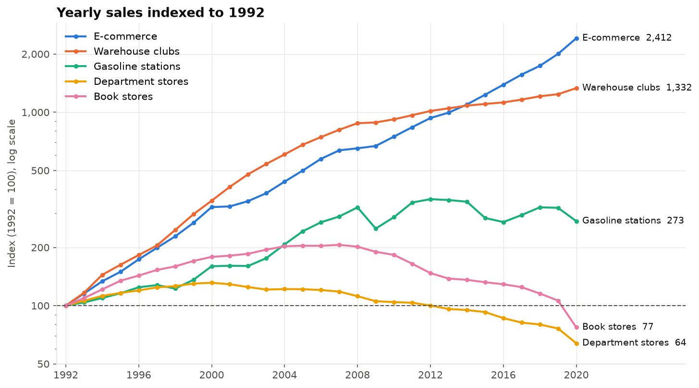

---

## Contents

- [Key results](#key-results)
- [How it works](#how-it-works)
- [1. Trends and seasonality](#1-trends-and-seasonality)
- [2. Change-point detection](#2-change-point-detection)
- [3. Forecast](#3-forecast)
- [4. Extended analysis](#4-extended-analysis)
- [Business hypotheses](#business-hypotheses)
- [SQL techniques used](#sql-techniques-used)
- [Reproduce it](#reproduce-it)
- [Repository layout](#repository-layout)
- [Data and limitations](#data-and-limitations)
- [Chart gallery](#chart-gallery)

---

## Key results

| # | Result |
|---|---|
| 1 | **E-commerce grew 11.7% a year** (1992-2019) vs 4.2% for all retail, rising from 1.9% to **15.2% of U.S. retail sales**. |
| 2 | E-commerce **passed department stores in 2007** and was **7.5x their size** by 2020. |
| 3 | **Department stores peaked in 2000** and declined in 19 of the next 20 years. Confirmed trend break: **Nov-Dec 2001**. |
| 4 | **Book stores peaked in 2007**; the decline after late 2008 never reversed. 2020 sales were **62.6% below peak**. |
| 5 | **Warehouse clubs never declined but slowed in steps**: 13.4% a year, then 9.4% (2004), then 3.3% (2009). |
| 6 | **Gasoline stations follow oil prices**: 9 confirmed turns that line up with oil price moves. |
| 7 | **Department stores 2023 forecast: $113B** (95% interval $104B to $121B); **$96B** if the 2020 drop is permanent. |
| 8 | **Recessions ratchet decliners down**: department and book stores never regained their pre-2008 level. |
| 9 | **The December spike is shrinking** in every holiday category (department stores: +86% vs trend in 1992, +67% in 2019). |
| 10 | **Calendar noise is large**: one extra weekend day vs last year cuts e-commerce YoY growth by 2.7 points. |

---

## How it works

All analysis runs in PostgreSQL. SQL files build a chain of views; each query selects from them. The notebook executes the SQL, pulls results into pandas, and draws the charts. Python is used on its own only for three statistical cross-checks (PELT, Holt-Winters, STL).

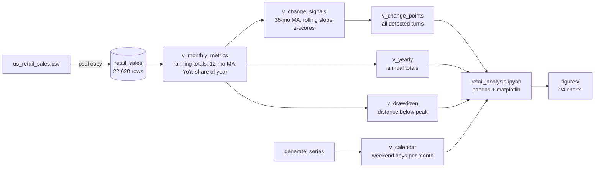

| Step | Question | SQL file | Charts |
|---|---|---|---|
| 1 | Load and validate the data | `sql/01_load.sql` | |
| 2 | How did monthly and yearly sales evolve? | `sql/02_trends.sql` | 1-3 |
| 3 | Where did the trajectory change? | `sql/03_change_points.sql` | 4-5 |
| 4 | What happens over the next three years? | `sql/04_forecast.sql` | 6-10 |
| 5 | Market share, recessions, COVID, correlations, calendar | `sql/05_extended.sql` | 11-24 |

---

## 1. Trends and seasonality

Every metric is computed with window functions **beside** each monthly row, so the monthly detail is never collapsed:

```sql
-- excerpt: sql/02_trends.sql  (view v_monthly_metrics)
SUM(sales) OVER (PARTITION BY kind_of_business
                 ORDER BY sales_month
                 ROWS BETWEEN UNBOUNDED PRECEDING AND CURRENT ROW)   AS running_total,

SUM(sales) OVER (PARTITION BY kind_of_business, sales_year)          AS year_total,

CASE WHEN COUNT(sales) OVER w12 = 12
     THEN AVG(sales) OVER w12 END                                    AS ma_12,   -- removes seasonality

LAG(sales, 12) OVER (PARTITION BY kind_of_business
                     ORDER BY sales_month)                           AS sales_ly,
...
WINDOW w12 AS (PARTITION BY kind_of_business ORDER BY sales_month
               ROWS BETWEEN 11 PRECEDING AND CURRENT ROW)
```

A 12-month window always holds one of each calendar month, so the December spike cancels and only the trend remains. The `COUNT = 12` guard blanks the first 11 months instead of averaging a partial window.

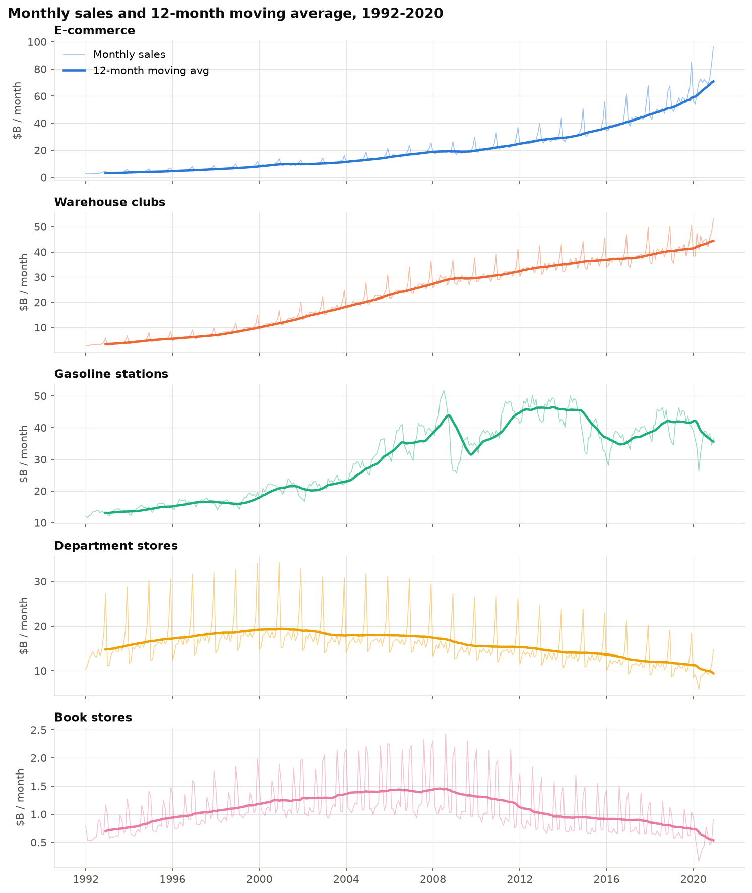

| Category | 1992 | 2019 | CAGR 1992-2019 | Peak year | 2020 vs 2019 |
|---|---|---|---|---|---|
| E-commerce | $35.2B | $705.5B | +11.7% | 2020 | +20.4% |
| Warehouse clubs | $40.0B | $496.2B | +9.8% | 2020 | +7.5% |
| Gasoline stations | $156.3B | $501.1B | +4.4% | 2012 | -14.7% |
| Book stores | $8.3B | $8.8B | +0.2% | 2007 | -27.4% |
| Department stores | $177.1B | $135.0B | -1.0% | 2000 | -16.2% |
| *Total retail* | | | *+4.2%* | | |

**Seasonality.** Share of annual sales by calendar month, 1992-2019 (a flat year is 8.3% per month):

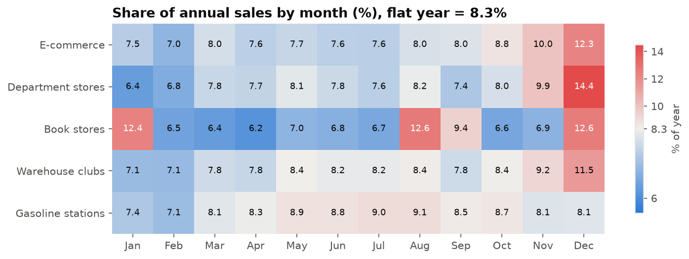

- Department stores are the most holiday-dependent category (December = 14.4% of the year).
- Book stores peak three times: January, August and December. January and August line up with college semester starts.
- Gasoline is the only category without a December peak; it peaks in the summer driving season.

---

## 2. Change-point detection

Three rule-based detectors run in SQL on de-seasonalized signals, plus a formal algorithm (PELT) in Python as an independent check.

| Method | Signal | Rule |
|---|---|---|
| **A. Moving-average crossover** | `ma_12` vs `ma_36` | the fast trend crosses the slow one |
| **B. Local slope reversal** | `REGR_SLOPE(ma_12)` over a rolling 24 months | the slope changes sign **and holds 6 months** |
| **C. Standard-deviation shock** | monthly YoY vs its trailing 36-month mean and SD | \|z\| >= 3; consecutive months merged (gaps-and-islands) |
| **PELT** *(Python, `ruptures`)* | rolling slope series | penalized optimal segmentation |

A change point counts as **confirmed** when two or more methods fire in the same direction within 12 months.

```sql
-- excerpt: sql/03_change_points.sql
-- B. local slope: least-squares slope of ma_12 over the last 24 months,
--    as % of the current level per year
CASE WHEN COUNT(ma_12) OVER w24 = 24
     THEN ROUND(100 * 12 * (REGR_SLOPE(ma_12, t) OVER w24)::numeric / ma_12, 2)
END AS trend_pct_yr,

-- C. YoY growth vs its own recent history (current month excluded)
(yoy_pct - AVG(yoy_pct) OVER prior36) / NULLIF(STDDEV(yoy_pct) OVER prior36, 0) AS yoy_z
...
WINDOW prior36 AS (PARTITION BY kind_of_business ORDER BY sales_month
                   ROWS BETWEEN 36 PRECEDING AND 1 PRECEDING)
```

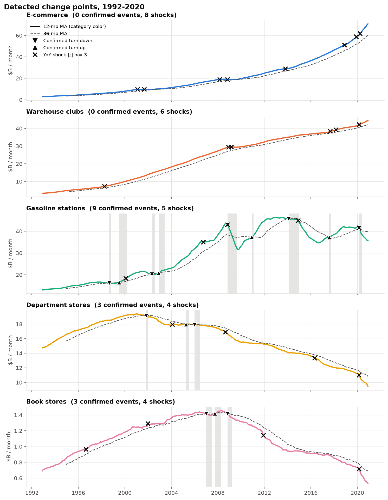

| Category | Confirmed events | Key turns |
|---|---|---|
| Gasoline stations | 9 | 1998 down, 1999 up, 2008 down, 2014 down, 2020 down (these line up with oil price moves) |
| Department stores | 3 | **Nov 2001 down**, 2005 brief recovery, 2006 down for good |
| Book stores | 3 | 2007 peak, **Nov 2008 down** for good |
| E-commerce | 0 | never turned down; slowdowns only (below) |
| Warehouse clubs | 0 | never turned down; slowdowns only (below) |

Growth categories never trigger a reversal, so their change points are **shifts in growth rate**. PELT finds them on the local-slope series:

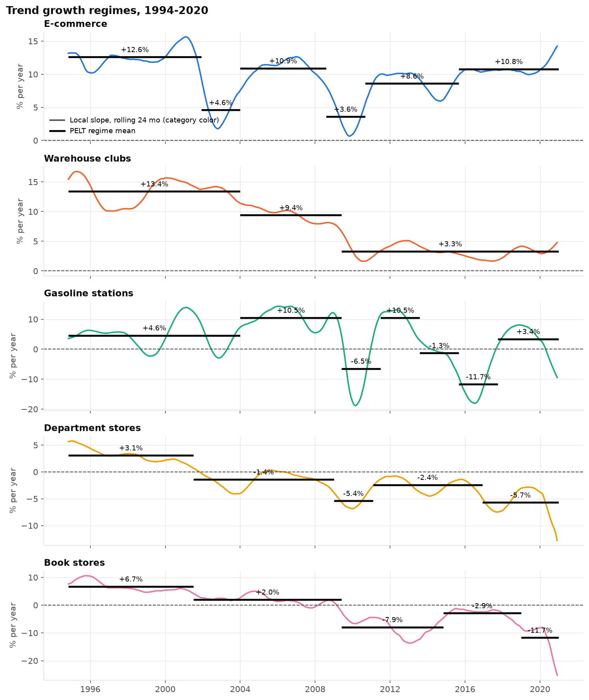

- **Warehouse clubs**: +13.4% a year until 2003, +9.4% to mid-2009, +3.3% after.
- **E-commerce**: dips to +4.6% after the dot-com bust and +3.6% in 2008-2010, then back above +10%.
- **Calendar artifacts**: e-commerce's November 2019 (+4.9% YoY) and December 2019 (+26.7%) follow Thanksgiving on Nov 28, 2019, which moved Cyber Monday into December. Requiring two methods to agree filters out one-month flags like this.

---

## 3. Forecast

**Target: Department stores, 2021-2023.** Five methods are computed in SQL on a 2010-2019 fit window (after the Great Recession, before COVID), with Holt-Winters as a benchmark.

| Method | How | SQL |
|---|---|---|
| M1 Linear trend | straight line with a 95% prediction interval | `REGR_SLOPE`, `REGR_INTERCEPT`, `REGR_SXX`, `REGR_SYY` |
| M2 Log-linear | constant % change per year | `REGR_SLOPE(LN(sales), year)` |
| M3 Flat moving average | last 12-month average held constant | `ma_12` |
| M4 Moving average + drift | 12-month average extended by its 2-year slope | `ma_12` |
| M5 Rebased trend | M1's slope restarted from the 2020 actual ("no recovery") | |
| Holt-Winters | damped trend, multiplicative seasonality | `statsmodels` |

The prediction interval is built entirely from Postgres regression aggregates:

```sql
-- excerpt: sql/04_forecast.sql
-- se = sqrt(SSE / (n - 2)),  SSE = Syy - Sxy^2 / Sxx
SQRT((REGR_SYY(year_sales, sales_year)
      - POWER(REGR_SXY(year_sales, sales_year), 2) / REGR_SXX(year_sales, sales_year))
     / (REGR_COUNT(year_sales, sales_year) - 2)) AS se
...
-- 95% prediction interval, t(0.975, df = 8) = 2.306
a + b * yr +/- 2.306 * se * SQRT(1 + 1.0 / n + POWER(yr - xbar, 2) / sxx)
```

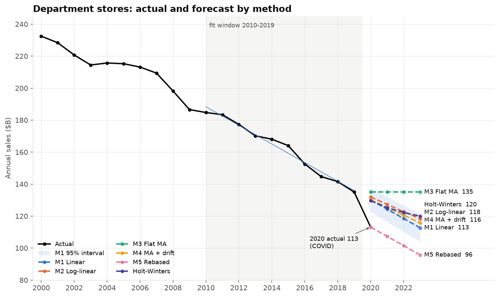

| Method | 2021 | 2022 | 2023 |
|---|---|---|---|
| M1 Linear trend | $124.3B | $118.5B | **$112.7B** |
| M1 95% interval | $116.5B to $132.1B | $110.3B to $126.7B | $104.1B to $121.3B |
| M2 Log-linear | $127.3B | $122.8B | $118.4B |
| M4 Moving average + drift | $125.4B | $120.6B | $115.7B |
| M5 No recovery | $107.3B | $101.5B | **$95.7B** |
| Holt-Winters | $125.3B | $122.2B | $120.0B |

- **Central estimate for 2023: $113B to $120B**, down 11% to 17% from 2019. **Downside: $96B.**
- 2020 actual ($113.1B) landed **13.1% below trend and outside the 95% interval**: COVID is a structural break, not ordinary noise.

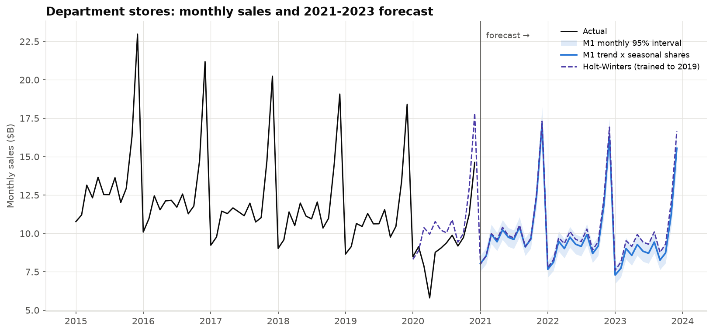

**Backtest** (fit 2010-2016, predict 2017-2019): no single method wins everywhere.

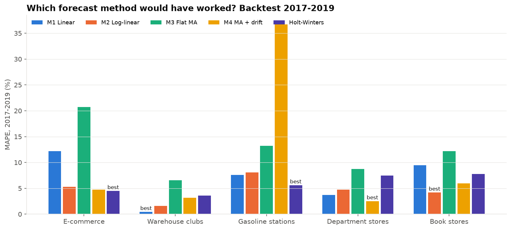

| Category | Best method | MAPE |
|---|---|---|
| Department stores | M4 moving average + drift | 2.5% |
| Warehouse clubs | M1 linear | 0.4% |
| Book stores | M2 log-linear | 4.2% |
| E-commerce | Holt-Winters | 4.5% |
| Gasoline stations | Holt-Winters | 5.6% |

**Fit-window sensitivity**: every more recent window gives a steeper decline, so the drop is accelerating.

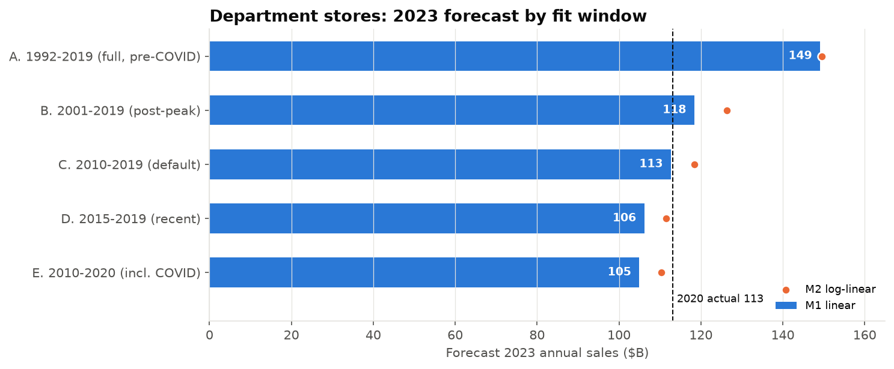

---

## 4. Extended analysis

### Market share and the e-commerce crossover

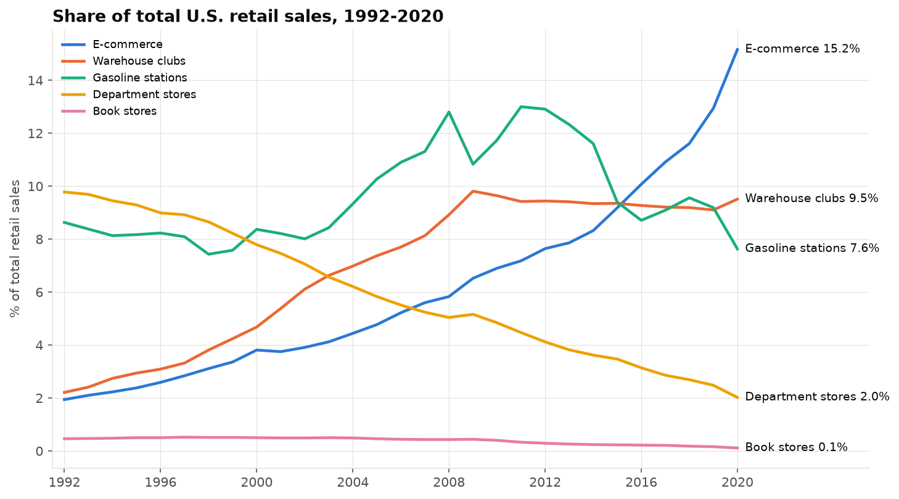

| Category | Share 1992 | Share 2020 | Change |
|---|---|---|---|
| E-commerce | 1.9% | 15.2% | +13.2 pts |
| Warehouse clubs | 2.2% | 9.5% | +7.3 pts |
| Gasoline stations | 8.6% | 7.6% | -1.0 pts |
| Department stores | 9.8% | 2.0% | -7.8 pts |
| Book stores | 0.46% | 0.11% | -0.35 pts |

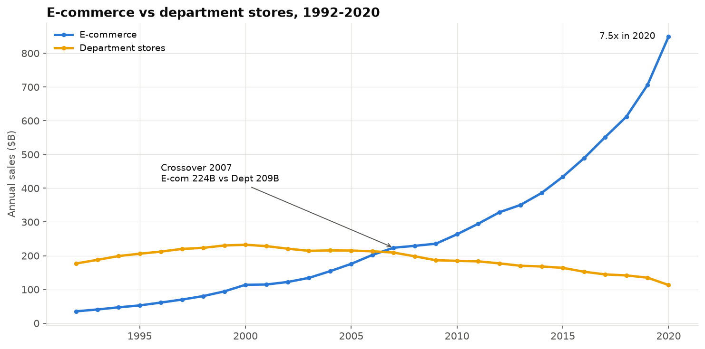

The crossover took three years: the first month in January 2006, the first full year in 2007, and department stores' last lead in December 2008.

### Recessions: who recovers?

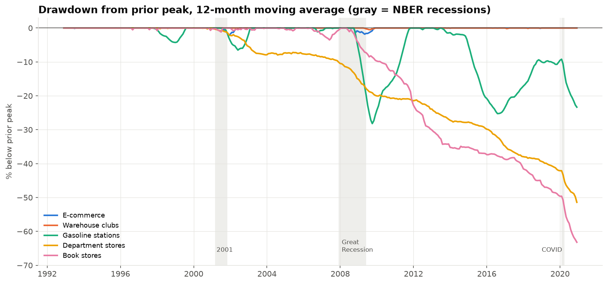

- **Recession-proof**: warehouse clubs didn't decline in any of the three recessions; e-commerce didn't decline in 2008-09 or 2020.
- **Cyclical**: gasoline fell 16.4% in the Great Recession and recovered in 37 months.
- **Ratchet**: department and book stores never regained their pre-recession level; each recession reset them lower.

### COVID-19

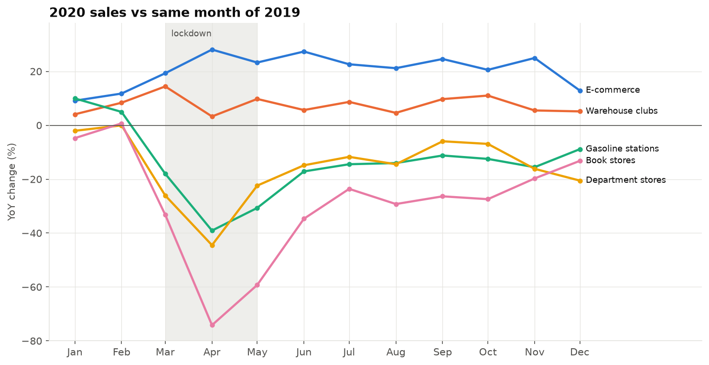

| Category | Lockdown (Mar-May) | Reopening (Jun-Dec) | Worst month |
|---|---|---|---|
| E-commerce | +23.6% | +22.0% | Jan +9.1% |
| Warehouse clubs | +9.2% | +7.2% | Apr +3.3% |
| Gasoline stations | -29.3% | -13.4% | Apr -39.1% |
| Department stores | -31.0% | -12.9% | Apr -44.5% |
| Book stores | -55.6% | -24.9% | Apr -74.2% |

Across **all 51 industry categories**, 2020's winners were home-centered and online (sporting goods +21.8%, hardware +19.7%, grocery +13%); losers were apparel, gifts and browsing-based stores. Traditional department stores fell 48.6%, while discount department stores fell only 1.6%.

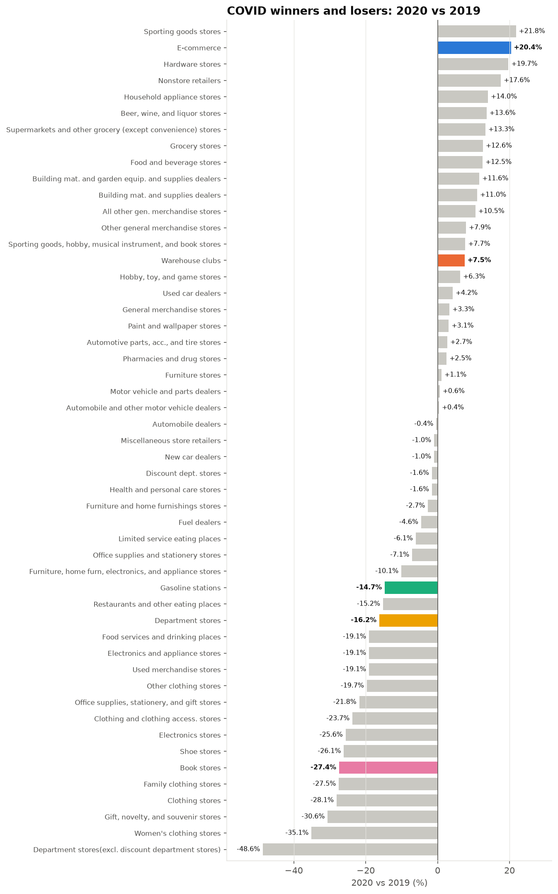

### Calendar effects

The data isn't trading-day adjusted, so a month's weekend count distorts its YoY growth:

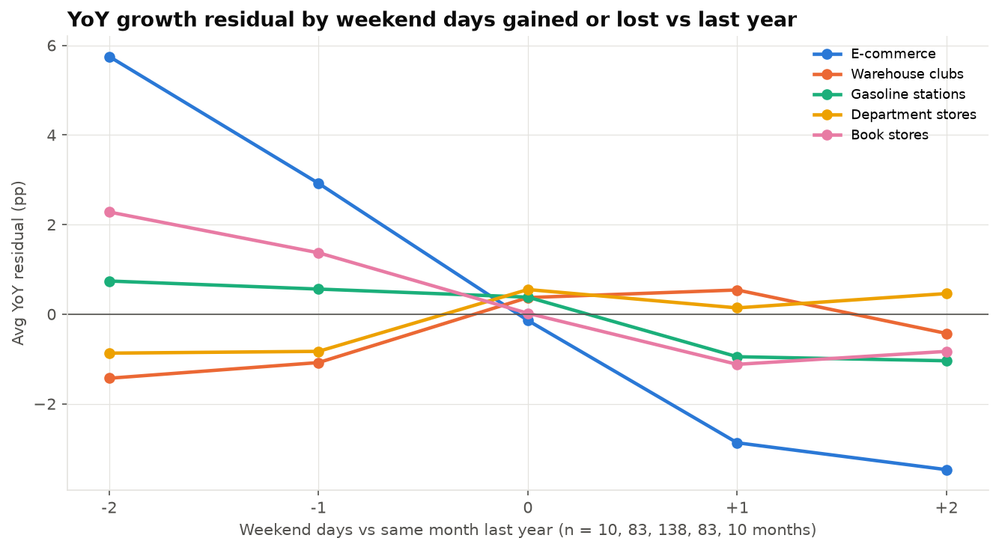

| Category | YoY points per extra weekend day | Correlation |
|---|---|---|
| E-commerce | -2.70 | -0.58 |
| Book stores | -1.09 | -0.20 |
| Department stores | +0.43 | +0.16 |
| Warehouse clubs | +0.63 | +0.24 |

Online buying concentrates on weekdays and store trips on weekends. For e-commerce, the swing between -2 and +2 weekend days is about 9 points of YoY growth.

### Holiday concentration is falling

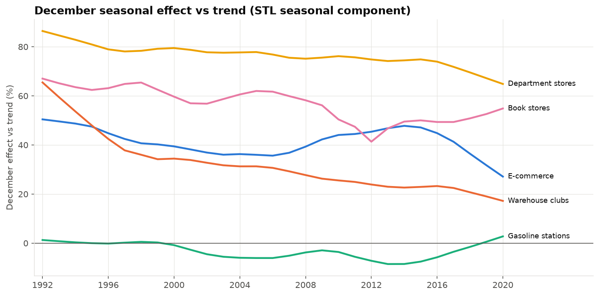

STL decomposition (trend-adjusted) shows the December bump shrinking in every holiday category: warehouse clubs +66% to +19%, department stores +86% to +67%, e-commerce +50% to +32% (1992 vs 2019). November's share fell too, so spending did not simply move earlier; it spread across the year.

### More in the notebook

- **Long-run growth leaderboard** across 51 categories: e-commerce #1, warehouse clubs #2, department stores #50 ([chart](figures/18_growth_leaderboard.png)).
- **Correlation and market beta**: store categories move together (r up to 0.68); e-commerce and department stores correlate *positively* month to month (0.35), so substitution shows only in long-run levels ([chart](figures/19_correlation.png), [chart](figures/20_market_beta.png)).
- **Volatility regimes**: gasoline's volatility peaked in 2008-2012 with oil prices ([chart](figures/21_rolling_volatility.png)).

---

## Business hypotheses

| # | Hypothesis | Evidence | How to test |
|---|---|---|---|
| H1 | Department stores lost share to warehouse clubs and discount formats, not only to e-commerce | Warehouse clubs gained 7.6 pts of share (1992-2009) while department stores lost 4.6; discount held in 2020 (-1.6%) while traditional fell (-48.6%) | Decompose share changes; compare discount vs traditional series |
| H2 | Book stores are a textbook business as much as a gift business | January and August peaks match semester starts | Compare with enrollment calendars; track the Aug/Jan peaks as digital textbooks grew |
| H3 | The book store collapse came from Borders' exit plus e-readers, not the recession alone | Break in late 2008; largest non-COVID shock in Dec 2011, the first holiday after Borders closed | Intervention model with e-reader sales data |
| H4 | Gasoline station sales measure oil prices more than demand | 9 turns aligned with oil prices; lowest correlation with other categories | Regress on EIA gasoline prices; deflate to volume |
| H5 | Warehouse clubs saturated after 2009 | Growth fell to 3.3% a year; market share flat near 9% | Store counts and membership data |
| H6 | Recessions accelerate structural decline | Decliners never recovered; growers had no drawdown | Pre/post-recession slopes across more categories |
| H7 | Monthly comparisons need calendar adjustment | Weekend mix swings e-commerce YoY by about 9 points; Thanksgiving moves Cyber Monday between months | Rebuild YoY on seasonally and trading-day adjusted Census series |

---

## SQL techniques used

| Technique | Where |
|---|---|
| `SUM` / `AVG` / `COUNT` `OVER (PARTITION BY ... ORDER BY ... ROWS BETWEEN ...)` | running totals, YTD, moving averages |
| Named windows (`WINDOW w AS (...)`) | every view |
| `LAG`, `FIRST_VALUE`, `ROW_NUMBER`, `RANK`, `PERCENT_RANK` | YoY, indexing, peaks, rankings |
| Regression aggregates `REGR_SLOPE`, `REGR_INTERCEPT`, `REGR_R2`, `REGR_SXX`, `REGR_SYY`, `REGR_SXY` | rolling slope, forecasts, prediction intervals, market beta |
| Windowed regression (`REGR_SLOPE(...) OVER w24`) | local slope for change points |
| `CORR`, `STDDEV` (plain and windowed) | co-movement, rolling volatility, z-scores |
| Conditional aggregation `... FILTER (WHERE ...)` | pivots, era summaries |
| Gaps-and-islands (`date - ROW_NUMBER() * interval`) | merging consecutive shock months |
| `generate_series` | forecast horizons, day-by-day calendar |
| `DISTINCT ON`, self-joins, CTE chains, views | troughs, confirmation logic, pipeline |

---

## Reproduce it

**Requirements:** PostgreSQL 16+ (local or Azure Database for PostgreSQL) and Python 3.11+.

```bash
git clone https://github.com/JacobWillson13/retail-sales-timeseries-sql.git
cd retail-sales-timeseries-sql

python3 -m venv .venv
source .venv/bin/activate
pip install -r requirements.txt

cp .env.example .env          # fill in host, user, password, database
createdb retail               # or CREATE DATABASE retail; in any client
```

Then either:

- **Notebook:** open `retail_analysis.ipynb` and Run All. It creates the table, loads the CSV (`COPY FROM STDIN`), builds every view, runs every query and saves all 24 charts to `figures/`.
- **SQL only:** run `sql/01_load.sql` to `sql/05_extended.sql` in order in any Postgres client. Load the CSV after the table exists:
  ```bash
  psql -h localhost -U <user> -d retail \
    -c "\copy retail_sales FROM 'data/us_retail_sales.csv' WITH (FORMAT csv, HEADER true)"
  ```

Every file is safe to rerun (`CREATE TABLE IF NOT EXISTS`, `CREATE OR REPLACE VIEW`). Each query is tagged `-- name: <id>`, so it can be run on its own or loaded by name from the notebook.

---

## Repository layout

```
├── README.md
├── requirements.txt
├── .env.example                connection template (local and Azure)
├── data/
│   └── us_retail_sales.csv     22,620 rows, 65 categories, 1992-2020
├── sql/
│   ├── 01_load.sql             table DDL and data checks
│   ├── 02_trends.sql           window functions, trends, seasonality
│   ├── 03_change_points.sql    crossover, slope, z-score detectors
│   ├── 04_forecast.sql         5 forecast methods, backtest, sensitivity
│   └── 05_extended.sql         10 extended analyses
├── retail_analysis.ipynb       executes the SQL, charts, findings
└── figures/                    24 charts (PNG)
```

---

## Data and limitations

**Source:** U.S. Census Bureau, Monthly Retail Trade Survey, as packaged in the companion repository for *SQL for Data Analysis* by Cathy Tanimura (O'Reilly, 2021), Chapter 3: [cathytanimura/sql_book](https://github.com/cathytanimura/sql_book).

- Nominal dollars in millions; not adjusted for inflation, seasonality or trading days.
- "E-commerce" is the Census category *Electronic shopping and mail-order houses*: it includes catalog sellers and excludes online sales by store-based retailers.
- Aggregate rows (totals, GAFO, "excl." rollups) have a NULL `naics_code` and are used only as the market benchmark.
- Forecasts rest on 10 annual observations and assume the 2010-2019 pattern holds; the data ends in December 2020, mid-pandemic.

---

## Chart gallery

<details>
<summary><b>All 24 charts</b> (click to expand)</summary>

| # | Chart | # | Chart |
|---|---|---|---|
| 1 | [Monthly sales + 12-mo MA](figures/01_monthly_ma12.png) | 13 | [December share of sales](figures/13_december_share.png) |
| 2 | [Yearly sales indexed to 1992](figures/02_yearly_index.png) | 14 | [Drawdowns from peak](figures/14_drawdowns.png) |
| 3 | [Seasonality heatmap](figures/03_seasonality.png) | 15 | [Recession impact](figures/15_recession_impact.png) |
| 4 | [Change points](figures/04_change_points.png) | 16 | [COVID monthly YoY](figures/16_covid_monthly.png) |
| 5 | [Trend regimes (PELT)](figures/05_trend_regimes.png) | 17 | [COVID winners and losers](figures/17_covid_all_categories.png) |
| 6 | [Dept. stores annual forecast](figures/06_dept_forecast_annual.png) | 18 | [Growth leaderboard](figures/18_growth_leaderboard.png) |
| 7 | [Dept. stores monthly forecast](figures/07_dept_forecast_monthly.png) | 19 | [Correlation matrix](figures/19_correlation.png) |
| 8 | [Backtest error](figures/08_backtest_mape.png) | 20 | [Market beta](figures/20_market_beta.png) |
| 9 | [Fit-window sensitivity](figures/09_forecast_sensitivity.png) | 21 | [Rolling volatility](figures/21_rolling_volatility.png) |
| 10 | [All-category forecasts](figures/10_all_category_forecasts.png) | 22 | [Calendar effect](figures/22_calendar_effect.png) |
| 11 | [Share of total retail](figures/11_share_of_retail.png) | 23 | [STL decomposition](figures/23_stl_department.png) |
| 12 | [E-commerce vs dept. stores](figures/12_ecom_vs_dept.png) | 24 | [December effect (STL)](figures/24_stl_december_effect.png) |

</details>

---

**Jacob Willson** · M.S. Data Science, SUNY Polytechnic Institute · Originally developed for DSA 508.
